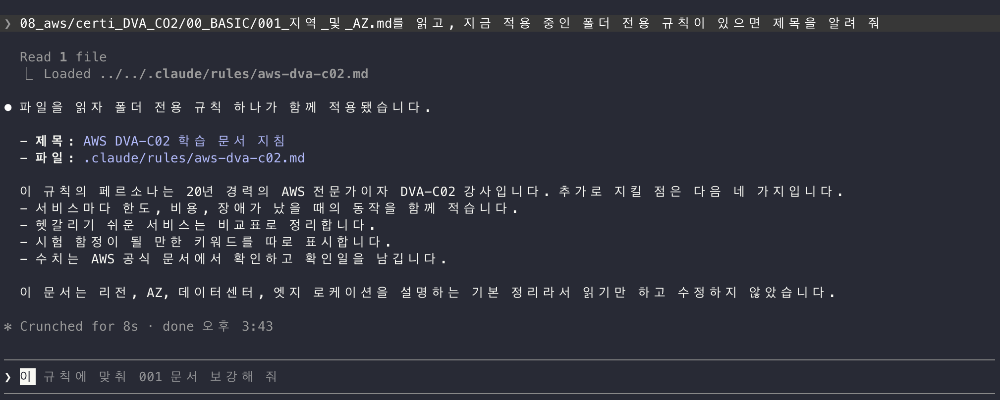

# 특정 폴더에만 적용되는 전용 지침 만들기

저장소 전체에 적용되는 지침은 루트의 `CLAUDE.md`(**claude**)와 `AGENTS.md`(**codex**)에 둡니다.
그런데 특정 폴더의 문서를 만들 때만 다른 관점이나 규칙이 필요할 때가 있습니다. 예를 들어 AWS 자격증
학습 노트를 쓸 때만 20년 차 인프라·서버·개발 전문가의 시각으로 설명하게 하고 싶다면, 이 내용을 루트
지침에 넣으면 Git이나 React 문서에도 같은 페르소나가 적용됩니다.

이 문서는 `08_aws/certi_DVA_CO2/` 폴더를 예로 들어, Claude Code와 Codex에서 특정 폴더에만
적용되는 전용 지침을 만드는 과정을 정리합니다.

- 확인일: 2026-10-16
- 확인 환경: macOS, Claude Code `2.1.292`, `codex-cli 0.162.1`
- 공식 문서:
  - [Claude Code - How Claude remembers your project](https://code.claude.com/docs/en/memory),
  - [Codex - AGENTS.md](https://learn.chatgpt.com/docs/agent-configuration/agents-md)

## 개념

### 두 도구가 지침을 불러오는 방식

두 도구 모두 루트 지침은 그대로 두고, 폴더 전용 지침을 그 위에 더하는 구조입니다. 다만
하위 폴더 지침을 불러오는 시점이 다릅니다.

| 구분           | Claude Code                                                     | Codex                                      |
| -------------- | --------------------------------------------------------------- | ------------------------------------------ |
| 전용 지침 위치 | `.claude/rules/*.md`(`paths` 지정) 또는 하위 폴더의 `CLAUDE.md` | 하위 폴더의 `AGENTS.md`                    |
| 불러오는 시점  | 해당 경로의 파일을 읽거나 수정할 때                             | 세션을 시작할 때                           |
| 불러오는 범위  | 세션 중에 다룬 파일의 경로 기준                                 | 저장소 루트부터 **실행한 폴더까지**의 경로 |
| 충돌 시        | 두 지침이 모순되면 어느 쪽을 따를지 보장되지 않음               | 나중에 합쳐지는 하위 폴더 지침이 우선      |

핵심 차이는 Codex 쪽입니다. Codex는 시작할 때 저장소 루트부터 현재 작업 폴더까지 내려가며
폴더마다 `AGENTS.md`를 하나씩 모아 합칩니다. 그래서 저장소 루트에서 Codex를 실행하면
`08_aws/certi_DVA_CO2/AGENTS.md`는 이 경로에 포함되지 않아 자동으로 적용되지 않습니다.

### 페르소나는 행동으로 적기

"20년 차 전문가처럼 행동하라"는 한 줄만으로는 결과가 크게 달라지지 않습니다. 지침은 모델이
읽는 문맥일 뿐이므로, 그 전문가라면 **문서를 어떻게 쓸지**를 구체적인 행동으로 풀어 적어야
효과가 있습니다.

| 막연한 표현             | 행동으로 바꾼 표현                                             |
| ----------------------- | -------------------------------------------------------------- |
| 전문가답게 설명한다     | 시험 정답과 실무 선택이 다르면 둘을 나눠 설명한다              |
| 실무 경험을 살린다      | 서비스마다 한도, 비용, 장애 상황에서의 동작을 함께 적는다      |
| 이해하기 쉽게 쓴다      | 헷갈리기 쉬운 서비스(SQS와 SNS, ALB와 NLB)는 비교표로 정리한다 |
| 시험에 도움이 되게 쓴다 | 시험 문제의 함정이 되는 키워드를 따로 표시한다                 |
| 정확하게 쓴다           | 한도·요금·기본값은 AWS 공식 문서로 확인하고 확인일을 남긴다    |

루트 지침과 겹치는 내용은 다시 적지 않습니다. 루트 지침은 계속 적용되므로, 전용 지침에는
이 폴더에서만 달라지는 점과 루트 지침을 바꿔야 하는 부분만 적습니다.

## 1단계: 지침 내용 정하기

먼저 지침 파일 본문을 정합니다. 이 본문은 Claude Code와 Codex에서 함께 사용합니다.

```markdown
# AWS DVA-C02 학습 문서 지침

## 페르소나

20년간 인프라 설계, 서버 운영, 백엔드 개발을 모두 해 온 AWS 전문가이자
DVA-C02 강사의 관점에서 씁니다.

## 이 폴더에서 추가로 지킬 것

- 시험 정답과 실무 선택이 다르면 둘을 나눠 설명합니다.
- 서비스마다 한도, 비용, 장애 상황에서의 동작을 함께 적습니다.
- 헷갈리기 쉬운 서비스는 비교표로 정리합니다.
- 시험 함정이 되는 키워드는 따로 표시합니다.
- 한도·요금·기본값은 AWS 공식 문서로 확인하고 확인일을 남깁니다.
```

## 2단계: Claude Code용 지침 만들기

방법은 두 가지이며, 이 저장소에서는 A 방법을 권장합니다.

### A. 경로를 지정한 규칙 파일 (권장)

`.claude/rules/` 폴더에 규칙 파일을 만들고, 맨 위 YAML 머리말의 `paths`에 적용할 경로를
glob 패턴으로 적습니다.

```shell
mkdir -p .claude/rules
```

`.claude/rules/aws-dva-c02.md` 파일에 다음 내용을 작성합니다. `paths` 아래 본문은 1단계에서
정한 내용입니다.

```markdown
---
paths:
  - '08_aws/certi_DVA_CO2/**'
---

# AWS DVA-C02 학습 문서 지침

(1단계에서 정한 본문)
```

- Claude가 Read, Write, Edit 도구나 `cat`, `head` 같은 명령으로 경로에 맞는 파일을 다룰 때
  규칙을 불러옵니다.
- `paths`가 없는 규칙 파일은 세션을 시작할 때 항상 불러오므로, 폴더 전용으로 쓰려면 `paths`를
  반드시 적습니다.
- 지침 파일이 `.claude/` 안에 있으므로 GitBook으로 공개되는 문서 폴더에 섞이지 않습니다.

### B. 하위 폴더에 CLAUDE.md 두기

`08_aws/certi_DVA_CO2/CLAUDE.md`에 1단계 본문을 그대로 작성합니다. Claude가 그 폴더의 파일을
읽거나 수정할 때 함께 불러옵니다.

이 방법도 동작하지만, 지침 파일이 공개 문서 폴더 안에 놓입니다. `SUMMARY.md`에 등록하지
않으면 GitBook 목차에는 나오지 않지만, 공개 저장소에는 그대로 올라갑니다.

## 3단계: Codex용 지침 만들기

Codex에는 경로를 지정하는 규칙 파일이 없습니다. 대신 해당 폴더에 `AGENTS.md`를 하나 더
둡니다.

```shell
08_aws/certi_DVA_CO2/AGENTS.md
```

내용은 1단계 본문을 그대로 사용합니다. `paths` 머리말은 Codex가 사용하지 않으므로 넣지
않습니다.

### Codex는 해당 폴더에서 실행하기

앞에서 설명했듯이 Codex는 저장소 루트부터 실행한 폴더까지의 `AGENTS.md`만 합칩니다. 전용
지침을 확실하게 적용하려면 `-C`(`--cd`) 옵션으로 작업 폴더를 지정해 실행합니다.

```shell
codex -C 08_aws/certi_DVA_CO2
```

이렇게 실행하면 다음 순서로 지침이 합쳐집니다. 뒤에 붙은 지침일수록 우선합니다.

```shell
~/.codex/AGENTS.md                  # 개인 공통 지침 (있을 때)
AGENTS.md                           # 저장소 루트 지침
08_aws/certi_DVA_CO2/AGENTS.md      # 폴더 전용 지침
```

합친 지침의 크기는 기본 32KiB(`project_doc_max_bytes`)를 넘을 수 없습니다. 전용 지침은
짧게 유지합니다.

### Claude Code와 겹치지 않는 이유

Claude Code는 기본 설정에서 작업 폴더나 그 상위에 `CLAUDE.md`(`.claude/CLAUDE.md` 포함)가
있으면 `AGENTS.md`를 읽지 않습니다. 이 저장소에는 `.claude/CLAUDE.md`가 있으므로, Codex용
`AGENTS.md`가 Claude Code에 중복으로 적용되지 않습니다.

## 4단계: 적용 여부 확인하기

### Claude Code

- `/context`를 실행하면 세션 시작 때 불러온 `CLAUDE.md`와 규칙 파일이 **Memory files**
  목록에 나옵니다.
- `paths`를 지정한 규칙과 하위 폴더의 `CLAUDE.md`는 필요할 때 불러오므로, 세션을 막 시작한
  시점에는 목록에 없는 것이 정상입니다.
- 폴더 안의 문서 하나를 읽어 달라고 요청한 뒤, 터미널에 `Loaded` 줄과 지침 파일 경로가
  나오는지 확인합니다.
- 이 폴더 밖의 문서(예: `04_git/`)를 다룰 때는 페르소나가 적용되지 않는지도 함께
  확인합니다.

<br>



### Codex

폴더에서 실행한 뒤, 현재 적용 중인 지침을 요약해 달라고 요청합니다.

```shell
codex -C 08_aws/certi_DVA_CO2 "Summarize the current instructions."
```

응답에 루트 지침과 폴더 전용 지침의 내용이 모두 나오면 정상입니다. 저장소 루트에서 실행했을
때와 비교해 보면 차이를 확인할 수 있습니다.

## 주의점

- 지침은 모델이 읽는 문맥이지 강제 규칙이 아닙니다. 반드시 지켜야 하는 조건은 검사 스크립트나
  hook으로 따로 확인합니다.
- Claude Code용 규칙 파일과 Codex용 `AGENTS.md`는 본문이 같습니다. 한쪽을 고치면 다른 쪽도
  함께 고칩니다.
- `.claude/` 폴더를 커밋하지 않으면 규칙 파일은 지금 사용하는 컴퓨터에만 남습니다. 다른
  환경에서도 사용하려면 `.claude/rules/`를 함께 커밋합니다.
- 전용 지침이 루트 지침과 모순되면 Claude Code는 어느 쪽을 따를지 보장하지 않습니다. 루트
  지침을 바꾸는 부분은 "이 폴더에서는 ~로 합니다"처럼 범위를 분명히 적습니다.
